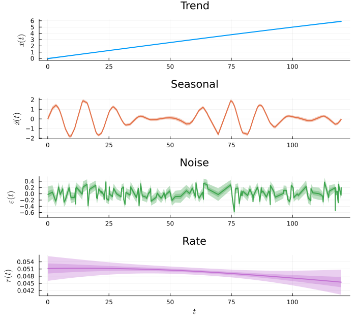

# TimeSeriesDecompositions.jl

Seasonal-trend decomposition of univariate time series, using [Gaussian processes](https://doi.org/10.1016/j.epidem.2026.100908) (GPs) or two classical methods, [X-11](https://link.springer.com/book/10.1007/978-3-319-31822-6) and [STL](https://www.proquest.com/docview/1266805989):

$$
y(t) = \bar x(t) + \tilde x(t) + \epsilon(t),
$$

where $y(t)$ is the data, and $\bar x(t)$, $\tilde x(t)$ and $\epsilon(t)$ are the trend(-cycle), seasonality and noise components, respectively. The rate of change

$$
\frac{\text d\bar x(t)}{\text dt} = r(t)
$$

is also computed.

For multiplicative decomposition $y(t) = \bar x(t) \tilde x(t) \epsilon(t)$, with exponential growth rate $\frac{\text d\bar x(t)}{\text dt} = r(t) \bar x(t)$, fit to $\log y(t)$ instead.

Future extensions will include multiple seasonality $\tilde x(t) = \tilde x_1(t) + \tilde x_2(t) + \dots$, as in [MSTL](https://www.inderscienceonline.com/doi/10.1504/IJOR.2025.143957).

## Installation

```julia-repl
pkg> add TimeSeriesDecompositions
```

## Usage

```julia
using TimeSeriesDecompositions
using Random, Plots

Random.seed!(42)
t = sort(120rand(150))    # irregular times
x̄ = 0.05t
x̃ = (1 .+ sin.(2π*t/60)) .* sin.(2π*t/12)    # time-varying seasonality
ϵ = 0.2randn(150)
y = x̄ .+ x̃ .+ ϵ

decomp = fit(GaussianProcess(), y, t; period=12)
display(plot(decomp))    # needs Plots.jl

t′ = t[1]-30:t[end]+30    # regular, inter/extrapolated times
decomp′ = predict(decomp, t′)    # values at new times (GP only)
display(plot(decomp′))

decomp.trend.mean, decomp.seasonal.std, decomp.noise.mean, decomp.rate.std
quantile(decomp.trend, (0.05, 0.95))    # interval bounds (GP only)
```



The GP model allows nonuniform sampling, outputs uncertainty for each component, and can be evaluated at any times, interpolating or extrapolating.

## License

[MIT](LICENSE)
